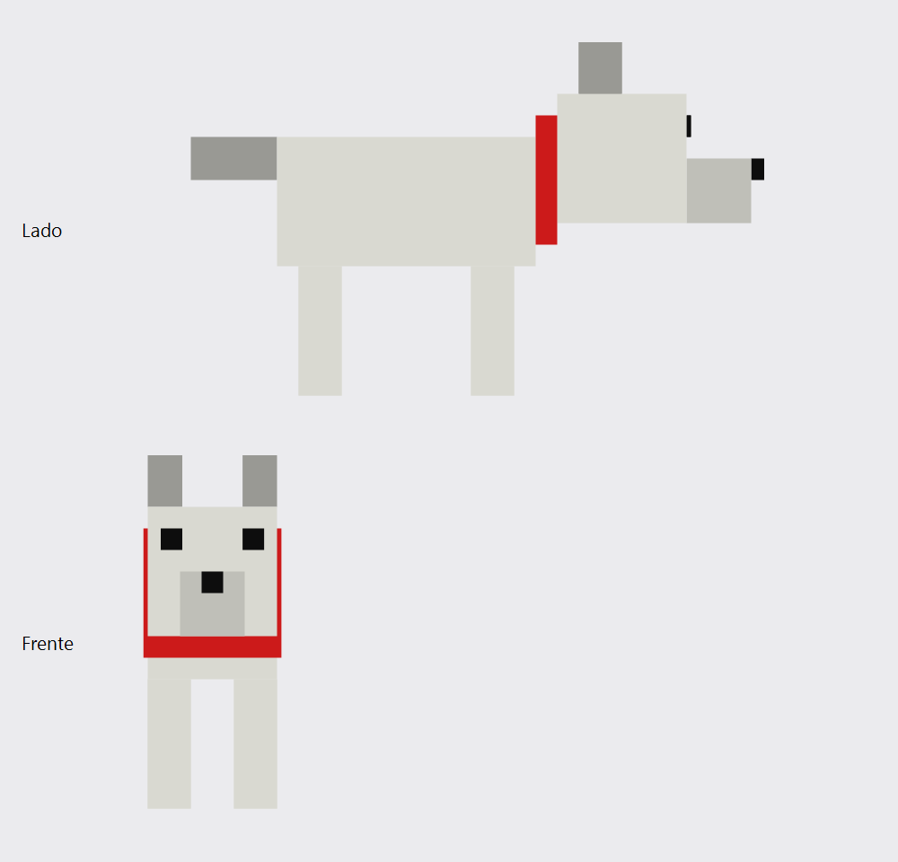

# Como fiz o cachorro em blocos (`cachorro.off`)



O cachorro é feito de **14 caixas** coloridas: corpo, cabeça, coleira, focinho, nariz, 2 orelhas, 2 olhos, 4 patas e rabo. O arquivo final tem **198 linhas**.

Este texto mostra o caminho completo, na ordem em que eu fiz:

1. Planejar o desenho em caixas.
2. Escrever o cabeçalho.
3. Escrever os cantos (vértices) de cada caixa.
4. Escrever os lados (faces) de cada caixa.
5. Conferir.

---

## 1. Planejar o desenho em caixas

### 1.1 Os eixos

Antes de qualquer número, decidi para onde cada eixo aponta:

| Eixo | Direção | Valores no cachorro |
|---|---|---|
| **x** | comprimento: do rabo para o focinho | de -2 (ponta do rabo) até 11.3 (ponta do nariz) |
| **y** | altura: do chão para cima | de 0 (chão) até 8.2 (ponta das orelhas) |
| **z** | largura: do lado esquerdo do cachorro para o direito | de 0 até 3 |

### 1.2 Pensando em cada parte

Uma caixa é descrita por **6 números**: onde ela começa e onde termina em cada eixo (**x0 e x1**, **y0 e y1**, **z0 e z1**).

Montei o cachorro de baixo para cima, pensando em como as partes se apoiam:

- **Corpo:** uma caixa de 6 × 3 × 3, flutuando de y = 3 a y = 6. O espaço embaixo (de y = 0 a 3) fica para as patas.
- **Patas:** 4 colunas finas (1 × 3 × 1), que vão do chão (y = 0) até a barriga (y = 3). Ficam nos 4 cantos do corpo: duas na frente (x de 4.5 a 5.5) e duas atrás (x de 0.5 a 1.5), e para cada par, uma à esquerda (z de 0 a 1) e uma à direita (z de 2 a 3).
- **Coleira:** uma fatia fina e vermelha (x de 6 a 6.5) logo depois do fim do corpo. Ela é um pouquinho mais larga que o corpo (z de -0.1 a 3.1), para "abraçar" o pescoço.
- **Cabeça:** um cubo de 3 × 3 × 3, logo depois da coleira (x de 6.5 a 9.5), um pouco mais alto que o corpo (y de 4 a 7).
- **Focinho:** sai da frente da cabeça (começa em x = 9.5) e é mais estreito (z de 0.75 a 2.25), centralizado no meio da cara.
- **Nariz:** um bloquinho preto na ponta do focinho.
- **Olhos:** placas pretas bem finas (x de 9.5 a 9.6), "coladas" na frente da cabeça.
- **Orelhas:** dois blocos em cima da cabeça (começam em y = 7, onde a cabeça termina), um em cada lado.
- **Rabo:** sai da traseira do corpo (termina em x = 0, onde o corpo começa) e vai para trás até x = -2.

> **Dica:** para uma peça "encostar" em outra, o começo de uma deve ser igual ao fim da outra. Exemplos: o rabo termina em x = 0 e o corpo começa em x = 0; as patas terminam em y = 3 e o corpo começa em y = 3.

### 1.3 A tabela do projeto

Coloquei tudo numa tabela. O número **k** é a posição da caixa na ordem em que ela entra no arquivo, começando em 0.

| k | Caixa | x0 | x1 | y0 | y1 | z0 | z1 | Cor (R G B) |
|---|---|---|---|---|---|---|---|---|
| 0 | corpo | 0 | 6 | 3 | 6 | 0 | 3 | 0.85 0.85 0.82 |
| 1 | cabeça | 6.5 | 9.5 | 4 | 7 | 0 | 3 | 0.85 0.85 0.82 |
| 2 | coleira | 6 | 6.5 | 3.5 | 6.5 | -0.1 | 3.1 | 0.80 0.10 0.10 |
| 3 | focinho | 9.5 | 11 | 4 | 5.5 | 0.75 | 2.25 | 0.75 0.75 0.72 |
| 4 | nariz | 11 | 11.3 | 5 | 5.5 | 1.25 | 1.75 | 0.05 0.05 0.05 |
| 5 | orelha esquerda | 7 | 8 | 7 | 8.2 | 0 | 0.8 | 0.60 0.60 0.58 |
| 6 | orelha direita | 7 | 8 | 7 | 8.2 | 2.2 | 3 | 0.60 0.60 0.58 |
| 7 | olho esquerdo | 9.5 | 9.6 | 6 | 6.5 | 0.3 | 0.8 | 0.05 0.05 0.05 |
| 8 | olho direito | 9.5 | 9.6 | 6 | 6.5 | 2.2 | 2.7 | 0.05 0.05 0.05 |
| 9 | pata dianteira esquerda | 4.5 | 5.5 | 0 | 3 | 0 | 1 | 0.85 0.85 0.82 |
| 10 | pata dianteira direita | 4.5 | 5.5 | 0 | 3 | 2 | 3 | 0.85 0.85 0.82 |
| 11 | pata traseira esquerda | 0.5 | 1.5 | 0 | 3 | 0 | 1 | 0.85 0.85 0.82 |
| 12 | pata traseira direita | 0.5 | 1.5 | 0 | 3 | 2 | 3 | 0.85 0.85 0.82 |
| 13 | rabo | -2 | 0 | 5 | 6 | 1 | 2 | 0.60 0.60 0.58 |

**As cores** vão de 0 a 1, em vez de 0 a 255:

- **Pelo claro (0.85 0.85 0.82):** um cinza quase branco, com um pouquinho menos de azul para ficar levemente amarelado.
- **Pelo escuro (0.60 0.60 0.58):** para orelhas e rabo.
- **Focinho (0.75 0.75 0.72):** um tom intermediário.
- **Preto (0.05 0.05 0.05):** para nariz e olhos. Não usei 0 puro para não ficar "chapado".
- **Vermelho (0.80 0.10 0.10):** para a coleira.

---

## 2. O cabeçalho (linhas 1 e 2)

```text
OFF
112 84 0
```

- **`OFF`:** o nome do formato. É sempre igual em qualquer arquivo `.off`.
- **`112`:** a quantidade de vértices. Cada caixa tem 8 cantos: 14 × 8 = **112**.
- **`84`:** a quantidade de faces. Cada caixa tem 6 lados: 14 × 6 = **84**.
- **`0`:** a quantidade de arestas. Ninguém usa, então fica sempre 0.

O arquivo inteiro tem 2 + 112 + 84 = **198 linhas**.

---

## 3. Os cantos de cada caixa (vértices)

### 3.1 Como os cantos são numerados

Toda caixa tem 8 cantos, sempre numerados assim (olhando a caixa de frente):

```text
 Parede de TRÁS (z0)        Parede da FRENTE (z1)
   0 ─────── 3                4 ─────── 7
   │         │                │         │
   │         │                │         │
   1 ─────── 2                5 ─────── 6
```

### 3.2 O molde

Cada canto é uma linha com **x y z**. Para qualquer caixa, os 8 cantos saem deste molde:

```text
x0 y1 z0     ← canto 0: trás, em cima, à esquerda
x0 y0 z0     ← canto 1: trás, embaixo, à esquerda
x1 y0 z0     ← canto 2: trás, embaixo, à direita
x1 y1 z0     ← canto 3: trás, em cima, à direita
x0 y1 z1     ← canto 4: frente, em cima, à esquerda
x0 y0 z1     ← canto 5: frente, embaixo, à esquerda
x1 y0 z1     ← canto 6: frente, embaixo, à direita
x1 y1 z1     ← canto 7: frente, em cima, à direita
```

Para memorizar, os 4 primeiros cantos usam **z0** e os 4 últimos usam **z1**. Nas duas metades, x e y seguem o mesmo padrão: (0,1), (0,0), (1,0), (1,1).

### 3.3 Exemplo: o corpo (k = 0)

Na tabela, o corpo tem x0 = 0, x1 = 6, y0 = 3, y1 = 6, z0 = 0 e z1 = 3. Trocando no molde:

```text
0 6 0
0 3 0
6 3 0
6 6 0
0 6 3
0 3 3
6 3 3
6 6 3
```

Essas são as **linhas 3 a 10** do arquivo, e viram os **vértices 0 a 7**.

### 3.4 Exemplo: a cabeça (k = 1)

A cabeça tem x0 = 6.5, x1 = 9.5, y0 = 4, y1 = 7, z0 = 0 e z1 = 3:

```text
6.5 7 0
6.5 4 0
9.5 4 0
9.5 7 0
6.5 7 3
6.5 4 3
9.5 4 3
9.5 7 3
```

Essas são as **linhas 11 a 18**, e viram os **vértices 8 a 15**.

Fiz o mesmo para as 14 caixas, **uma logo depois da outra, na ordem da tabela**. Só depois de terminar **todos** os vértices comecei as faces.

---

## 4. Os lados de cada caixa (faces)

### 4.1 Cada lado liga 4 cantos

Olhando o desenho da seção 3.1, os 6 lados de qualquer caixa usam sempre estes cantos:

| Lado | Cantos | Como achar no desenho |
|---|---|---|
| trás | 0 3 2 1 | o quadrado da esquerda inteiro |
| frente | 4 5 6 7 | o quadrado da direita inteiro |
| esquerda | 0 1 5 4 | a coluna da esquerda dos dois quadrados |
| cima | 0 4 7 3 | a linha de cima dos dois quadrados |
| direita | 3 7 6 2 | a coluna da direita dos dois quadrados |
| baixo | 1 2 6 5 | a linha de baixo dos dois quadrados |

A ordem dos cantos dá a volta pela borda do lado. Ela também diz qual lado é "de fora", então **não mude a ordem**: copie exatamente como está.

### 4.2 O que cada número da linha significa

Cada linha de face tem **9 números**:

```text
4    0 3 2 1    0.85 0.85 0.82    1.0
↑    ↑          ↑                 ↑
│    │          │                 └─ opacidade (1.0 = sólido)
│    │          └─ cor: vermelho, verde, azul (de 0 a 1)
│    └─ os 4 cantos que formam o lado
└─ quantos cantos o lado tem (sempre 4 para caixas)
```

### 4.3 Exemplo: o corpo (k = 0)

```text
4 0 3 2 1 0.85 0.85 0.82 1.00
4 4 5 6 7 0.85 0.85 0.82 1.00
4 0 1 5 4 0.85 0.85 0.82 1.00
4 0 4 7 3 0.85 0.85 0.82 1.00
4 3 7 6 2 0.85 0.85 0.82 1.00
4 1 2 6 5 0.85 0.85 0.82 1.00
```

### 4.4 A "soma": o passo mais importante

Os números dos cantos nas faces **não** são "o canto 0 desta caixa". Eles são **"o vértice número 0 do arquivo"**. Os vértices são contados na ordem em que aparecem, começando em 0.

Como o corpo foi escrito primeiro, ele ficou com os vértices 0 a 7. A cabeça veio depois, então os cantos dela são os vértices 8 a 15:

```text
Canto da cabeça no desenho:   0   1   2   3   4   5   6   7
Número dele no arquivo:       8   9  10  11  12  13  14  15
```

Por isso, nas faces da cabeça, **somei 8** a cada número de canto. A regra geral é:

> **Caixa k → some 8 × k aos 4 números de canto.**
> O primeiro `4` da linha **não** muda, porque é a quantidade de cantos, não um canto. A cor também não muda.

### 4.5 Exemplo: a cabeça (k = 1, soma 8)

```text
4 8 11 10 9 0.85 0.85 0.82 1.00       ← 0+8  3+8  2+8  1+8
4 12 13 14 15 0.85 0.85 0.82 1.00     ← 4+8  5+8  6+8  7+8
4 8 9 13 12 0.85 0.85 0.82 1.00       ← 0+8  1+8  5+8  4+8
4 8 12 15 11 0.85 0.85 0.82 1.00      ← 0+8  4+8  7+8  3+8
4 11 15 14 10 0.85 0.85 0.82 1.00     ← 3+8  7+8  6+8  2+8
4 9 10 14 13 0.85 0.85 0.82 1.00      ← 1+8  2+8  6+8  5+8
```

### 4.6 A soma e a posição de cada caixa no arquivo

| k | Caixa | Soma (8 × k) | Linhas dos vértices | Linhas das faces |
|---|---|---|---|---|
| 0 | corpo | 0 | 3–10 | 115–120 |
| 1 | cabeça | 8 | 11–18 | 121–126 |
| 2 | coleira | 16 | 19–26 | 127–132 |
| 3 | focinho | 24 | 27–34 | 133–138 |
| 4 | nariz | 32 | 35–42 | 139–144 |
| 5 | orelha esquerda | 40 | 43–50 | 145–150 |
| 6 | orelha direita | 48 | 51–58 | 151–156 |
| 7 | olho esquerdo | 56 | 59–66 | 157–162 |
| 8 | olho direito | 64 | 67–74 | 163–168 |
| 9 | pata dianteira esquerda | 72 | 75–82 | 169–174 |
| 10 | pata dianteira direita | 80 | 83–90 | 175–180 |
| 11 | pata traseira esquerda | 88 | 91–98 | 181–186 |
| 12 | pata traseira direita | 96 | 99–106 | 187–192 |
| 13 | rabo | 104 | 107–114 | 193–198 |

---

## 5. Conferindo

Antes de abrir no MeshLab, conferi:

1. **O total de linhas:** o arquivo tem **198 linhas**, igual a 2 + 112 + 84.
2. **O maior número de canto:** é **111**. Como existem 112 vértices (de 0 a 111), nenhum número pode passar disso. A última linha do arquivo é `4 105 106 110 109 0.60 0.60 0.58 1.00`, a face de baixo do rabo (1+104, 2+104, 6+104, 5+104).
3. **As colunas:** todas as 84 linhas de face têm exatamente **9 números**.
4. **Os decimais:** todos usam **ponto** (`0.85`), nunca vírgula.
5. **O desenho:** renderizei o cachorro de lado e de frente (a imagem do topo) para ver se cada peça estava no lugar.

> **Como eu escrevi o arquivo:** em vez de digitar as 198 linhas à mão, escrevi um pequeno programa em C++ que tem a tabela da seção 1.3 e, para cada caixa, aplica o molde dos vértices (seção 3.2) e o molde das faces com a soma (seção 4). O resultado é exatamente o que você faria à mão, só que sem erros de digitação. Esse é o mesmo trabalho que a função `writeOFF` do Sculptor vai fazer: um laço que passa por cada voxel ativo e escreve 8 vértices e 6 faces, somando 8 × (número do voxel) nos índices.

---

## 6. O que faltava no seu rascunho

Seu rascunho foi guardado em `explicacao/rascunho_cachorro.off`. Os vértices do corpo e da cabeça estavam **certos**. Os problemas eram:

| Linha(s) | Problema | Como fica certo |
|---|---|---|
| 2 | `112 84 0`, mas o arquivo só tinha 2 caixas | com só corpo e cabeça: `16 12 0` (2 × 8 e 2 × 6) |
| 21–30 | `R G B` é só um lugar reservado no molde; o programa precisa de números | trocar pela cor, por exemplo `0.85 0.85 0.82` |
| 22–30 | faltavam o `4` e os 4 números de canto no começo da linha | cada linha precisa dos 9 números completos |
| 32–37 | as faces do corpo estavam certas, mas a linha 21 já era uma face do corpo, então ficariam repetidas | 6 faces por caixa, nem mais nem menos |
| — | faltavam as 6 faces da cabeça | as linhas da seção 4.5, com a soma 8 |
| 11, 20, 31 | linhas em branco | o MeshLab costuma aceitar, mas é mais seguro não deixar |

---

## 7. Para praticar

Experimente estas mudanças no `cachorro.off` e abra no MeshLab depois de cada uma:

1. **Trocar a cor da coleira para azul:** nas linhas 127 a 132, troque `0.80 0.10 0.10` por `0.10 0.20 0.80`.
2. **Deixar o rabo mais comprido:** nos vértices do rabo (linhas 107 a 114), troque todo `-2` por `-3`. As faces não mudam, porque os cantos continuam sendo os mesmos vértices; só a posição deles mudou.
3. **Acrescentar uma caixa nova (por exemplo, uma língua rosa embaixo do focinho):**
   - Ela será a caixa **k = 14**, então a soma é **8 × 14 = 112**.
   - Escreva os 8 vértices dela **depois da linha 114**, no fim dos vértices.
   - Escreva as 6 faces dela **no fim do arquivo**, somando 112.
   - Mude a linha 2 para **`120 90 0`**.
   - Sugestão de coordenadas: x de 10 a 10.6, y de 3.6 a 4, z de 1.2 a 1.8, cor `0.95 0.45 0.55`.
